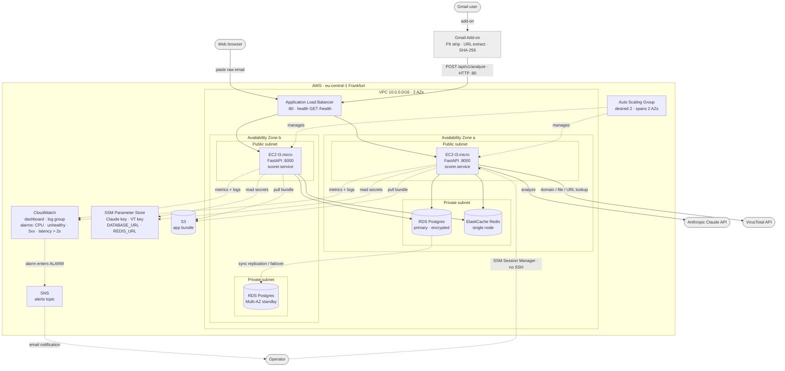

# AWS Architecture

Highly-available phishing scorer on AWS, region **eu-central-1 (Frankfurt)**.
Mirrors the Terraform in [`deploy/terraform/`](deploy/terraform/).

## Key decisions

| Choice | Why |
|---|---|
| **2 AZs, ASG desired=2** | One EC2 / one AZ can fail; ALB routes to the healthy host. |
| **RDS Multi-AZ** | Standby replica in AZ-b; automatic failover. The slow part of `apply` (~10–15 min). |
| **No NAT Gateway** | EC2 sits in public subnets with public IPs instead → saves ~$32/mo. |
| **SSM, not SSH** | No key pairs, no port 22. Shell via Session Manager; secrets via Parameter Store. |
| **ElastiCache Redis** | Shared whole-email result cache across both instances (not in-process). |
| **CloudWatch + SNS** | Dashboard + 4 alarms (CPU, unhealthy hosts, 5xx, latency > 2s) + app log group. Alarms publish to an SNS topic → email (set `alert_email` at apply). |

## Request flow

1. Gmail Add-on / browser → **ALB :80** → one of 2 EC2 (`GET /health` gates routing).
2. FastAPI checks the **ElastiCache** whole-email cache → hit returns immediately.
3. Miss → analyzers run in parallel, calling **Claude** + **VirusTotal** outbound.
4. Result cached in ElastiCache; scan history written to **RDS**; metrics/logs to **CloudWatch**.

> Infra source of truth is the Terraform in `deploy/terraform/`; update this diagram when the stack changes.
